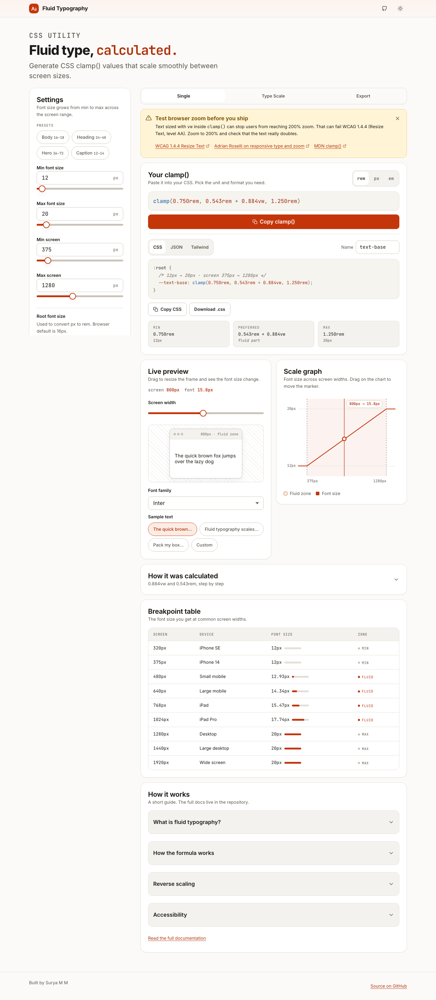

# Fluid Typography Generator

A small web tool that turns a min and max font size into one CSS `clamp()` value. The text then scales smoothly between two screen widths, with no media queries.



## Quick start

```bash
npm install
npm run dev        # http://localhost:3000/fluid-typography
```

Other scripts:

```bash
npm run build      # production build
npm test           # unit tests (node:test, no extra packages)
npm run lint       # ESLint
```

## Features

- `clamp()` output in **rem**, **px** and **em**
- Export as **CSS**, **JSON** or **Tailwind** config, with copy and download
- Live preview with a resizable frame and font picker
- SVG graph with a marker linked to the preview
- Type scale (xs to 3xl) with eight modular ratios and line height
- Breakpoint table, step-by-step formula, accessibility alerts
- Reverse scaling (text gets smaller on wider screens)
- Light and dark theme, follows your OS, remembers your choice
- All settings live in the URL, so you can share a link
- Works from 320px to ultrawide, touch friendly, keyboard friendly

## Documentation

| File | What is inside |
| --- | --- |
| [docs/ARCHITECTURE.md](docs/ARCHITECTURE.md) | Stack, folders, modules, key decisions |
| [docs/FLOW.md](docs/FLOW.md) | Data flow from input to copy, with diagrams |
| [docs/FORMULA.md](docs/FORMULA.md) | The math, worked examples, edge cases |
| [docs/COMPONENTS.md](docs/COMPONENTS.md) | Every component, its props and file |
| [docs/UI-DESIGN.md](docs/UI-DESIGN.md) | Tokens, colors, fonts, breakpoints, dark mode |
| [docs/EXPORT-FORMATS.md](docs/EXPORT-FORMATS.md) | CSS, JSON and Tailwind output |
| [docs/ACCESSIBILITY.md](docs/ACCESSIBILITY.md) | WCAG notes, zoom warning, testing checklist |
| [docs/TESTING.md](docs/TESTING.md) | Run, extend and audit |
| [docs/CONTRIBUTING.md](docs/CONTRIBUTING.md) | Setup, commits, style, pull requests |
| [CHANGELOG.md](CHANGELOG.md) | What changed |

## Other tools in this repo

`/fluid-spacing` generates `clamp()` values for padding, margin and gap, with a live preview, scaling curve and a spacing scale. It uses the same design system and components. Its math is in `src/lib/spacing.js` (see [ARCHITECTURE.md](docs/ARCHITECTURE.md)).
