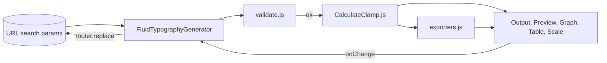

# Architecture

A short tour of how the app is built. Terms like "tokens" are explained in [UI-DESIGN.md](UI-DESIGN.md). The data path is in [FLOW.md](FLOW.md).

- [Stack](#stack)
- [Folder structure](#folder-structure)
- [Main modules](#main-modules)
- [How the parts connect](#how-the-parts-connect)
- [Key decisions](#key-decisions)

## Stack

| Part | Choice |
| --- | --- |
| Framework | Next.js 16 (App Router), React 19 |
| Language | JavaScript (components, lib) and TypeScript (route files) |
| Styling | Plain CSS with variables (`src/styles`) and a small reset. No CSS framework. |
| Fonts | Inter and JetBrains Mono through `next/font` (self-hosted at build time) |
| Chart | Hand-written SVG. No chart library. |
| Tests | `node:test` (built into Node) |
| Browser checks | Playwright and axe-core (dev only) |

Runtime dependencies: `next`, `react`, `react-dom`. Dev: `eslint`, `typescript`, `playwright`, `axe-core`.

## Folder structure

```text
src/
  app/
    layout.tsx               fonts, theme script, viewport
    page.tsx                 home (tool list)
    fluid-typography/
      page.tsx               Suspense + skeleton, imports app.css
      error.tsx              error state
    fluid-spacing/page.tsx   spacing tool route
  components/                UI (see COMPONENTS.md)
    CalculateClamp.js        the calculation (pure functions)
  lib/
    exporters.js             CSS / JSON / Tailwind strings
    spacing.js               spacing math, presets, validation
    validate.js              input validation
    highlight.js             tiny syntax highlighter
    clipboard.js, download.js
  styles/
    tokens.css               design tokens, both themes
    app.css                  component styles, scoped to .ft
scripts/                     gen-type-tokens, check-contrast, audit, screenshots, gen-doc-examples
tests/                       *.test.mjs
docs/                        these files and screenshots
```

## Main modules

| Module | Job |
| --- | --- |
| `CalculateClamp.js` | `calculateClamp`, `generateTypeScale`, `generateBreakpointTable`, `getPreviewFontSize`, `getFormulaSteps`, `getClampValue`. No React, no DOM. |
| `lib/validate.js` | Says which inputs are invalid, and why. |
| `lib/exporters.js` | Builds the export text for single value, type scale and saved configs. |
| `FluidTypographyGenerator.jsx` | The page. Reads settings from the URL, validates, calculates, and renders the tabs. |
| `useTheme.js` | Reads and sets `data-theme` on `<html>`. |
| `FluidSpacingGenerator.jsx` | The `/fluid-spacing` page. Uses the same shared components and styles. |
| `lib/spacing.js` | `computeClamp`, `valueAtVw`, spacing presets and `validateSpacing`. |

## How the parts connect



State rule: the URL is the single source of truth for the settings. Small UI state (selected format, font, ratio, saved list) stays inside the component that owns it.

## Key decisions

- **URL as state.** A refresh or a shared link restores everything. Writes use `router.replace`, so history is not filled.
- **Validate before calculating.** The calculation was left unchanged. Equal screens would give `Infinity`, so the UI blocks them. See [FORMULA.md](FORMULA.md#equal-or-reversed-screens).
- **CSS variables, not class branches.** The old code had an `isDark` branch in every component. Now one set of tokens is swapped by `data-theme`.
- **Theme before paint.** An inline script in `layout.tsx` sets `data-theme` from localStorage or the OS before the first paint, so there is no flash.
- **One design system for all pages.** Home, typography and spacing share the tokens, `app.css`, `Header`, `Card`, `Tabs`, `NumberField` and `ScaleGraph`. Tailwind was removed.
- **No chart library.** Recharts was removed. The graph is about 100 lines of SVG and resizes with `ResizeObserver`.
- **Fonts for the preview load on demand.** The old code loaded 16 Google Fonts at once. Now a font loads only when you pick it.
- **The app uses fluid type itself.** The `--step-*` tokens were generated by `scripts/gen-type-tokens.mjs` with the same `calculateClamp()`.
- **Tabs and radios follow WAI-ARIA.** See [ACCESSIBILITY.md](ACCESSIBILITY.md).
