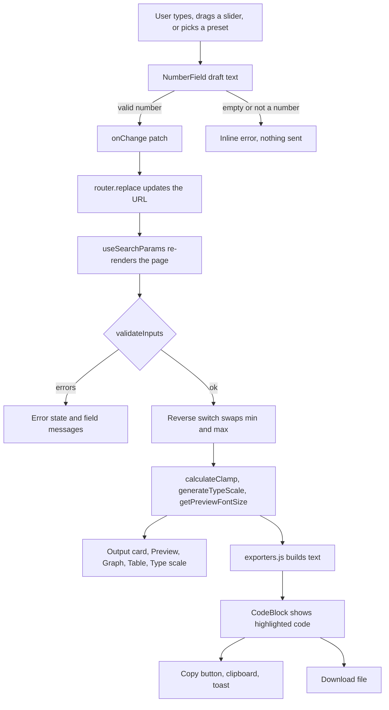
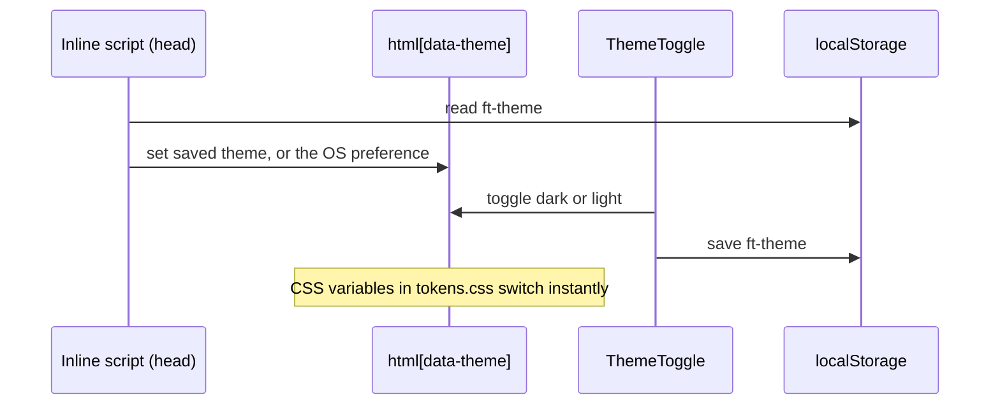

# Data flow

How a value travels from the input fields to the clipboard. For the file layout see [ARCHITECTURE.md](ARCHITECTURE.md). For the math see [FORMULA.md](FORMULA.md).

- [Overview](#overview)
- [Input and validation](#input-and-validation)
- [Calculation](#calculation)
- [Output, copy and export](#output-copy-and-export)
- [Theme flow](#theme-flow)

## Overview



## Input and validation

1. `NumberField` keeps a local text draft, so typing `1.` or clearing the box does not break anything.
2. Only a real number is passed up. Otherwise the field shows `Enter a number.` or `Use digits only, for example 16 or 16.5.`
3. The page stores the number in the URL: `?minFont=16&maxFont=24&minScreen=320&maxScreen=1280`.
4. On every render, `validateInputs()` checks ranges and that `minScreen < maxScreen`.

```text
Min font size must be between 1 and 500.
Max screen must be larger than min screen.
```

If any field is invalid, the tabs stay but their content is replaced by an error state. Nothing is calculated. This is what protects the math from a divide by zero.

URL parameters:

| Param | Meaning | Default |
| --- | --- | --- |
| `minFont`, `maxFont` | Font sizes in px | `12`, `20` |
| `minScreen`, `maxScreen` | Screen widths in px | `375`, `1280` |
| `rootSize` | Root font size in px | `16` |
| `previewScreen` | Preview width in px (kept inside the slider range) | `800` |
| `reverse` | `1` swaps min and max | off |
| `tab` | `Single`, `Type Scale` or `Export` | `Single` |
| `unit` | `rem`, `px` or `em` | `rem` |

## Calculation

When the input is valid, the page calls (all in `CalculateClamp.js`):

| Call | Used by |
| --- | --- |
| `calculateClamp(min, max, minScreen, maxScreen, root)` | Output card, Export |
| `generateTypeScale(..., ratio)` | Type scale, Export |
| `getPreviewFontSize(..., previewScreen)` | Preview, Graph marker |
| `generateBreakpointTable(...)` | Breakpoint table |
| `getFormulaSteps(...)` | Formula panel |

With **Reverse scaling** on, the page passes `maxFont` as the min and `minFont` as the max.

The preview slider range is `max(200, minScreen − 100)` to `maxScreen + 100`. The graph uses the same range, so the marker and the slider always match.

## Output, copy and export

1. `getClampValue(result, unit)` picks the rem, px or em string.
2. `buildSingle()` or `buildScale()` wraps it as CSS, JSON or Tailwind. See [EXPORT-FORMATS.md](EXPORT-FORMATS.md).
3. `CodeBlock` colors it with `tokenize()` from `lib/highlight.js`.
4. `CopyButton` calls `copyText()` (Clipboard API, with a fallback for plain http), shows **Copied!** on the button, and fires a toast in a `role="status"` region.
5. Download builds a `Blob` and clicks a temporary link (`lib/download.js`).

## Theme flow



If the user never chose a theme, `useTheme` follows later OS changes.
